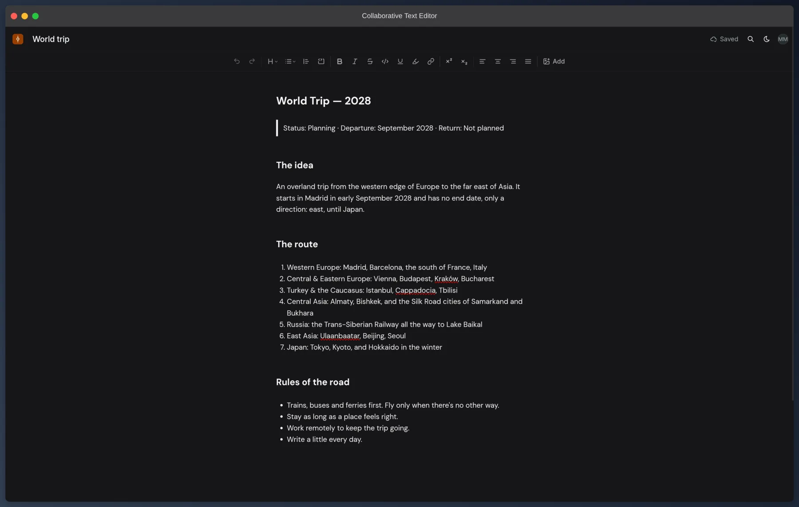
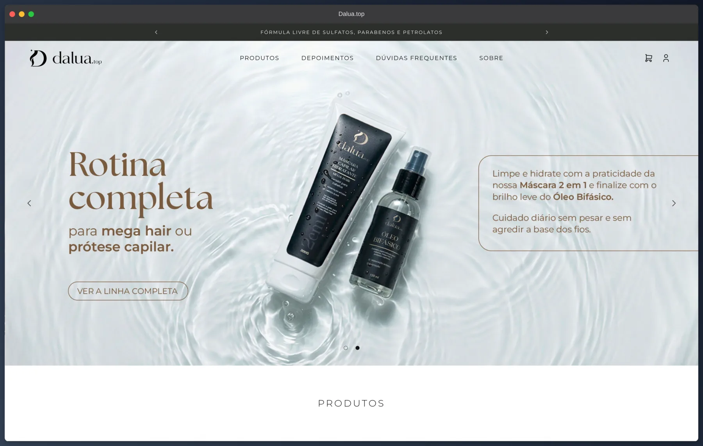

# Hi, I'm Mikael 👋

**Fullstack Engineer · 6+ years · TypeScript, React/Next.js, Node.js/Bun, AWS**

🌎 **Open to international opportunities** · Remote from Brazil (UTC-3, overlaps with US & EU) · English: fluent

🇧🇷 [Leia em Português](README.pt-BR.md)

---

I got into development building games in Unity3D and never stopped. What kept me here wasn't the tech itself, but the feeling of turning an idea into something that works. Today I build web, mobile, and backend systems across betting, enterprise automation, and logistics, and I'm comfortable owning delivery end to end, from architecture decisions to production.

## Impact highlights

- **Real-time failover on AWS.** Built an automated failover system across microservices that detects provider outages and switches over in real time, keeping a regulated betting platform available.
- **Billions of records, zero data loss.** Took part in a cross-continental migration from the EU to Brazil using AWS and Python.
- **~10% revenue growth.** Developed a fullstack referral system in a 2-person team.
- **4 days → 2 hours.** Designed an automation pipeline integrating 3 databases with Lecom, DocuSign, and Feedz via REST APIs.
- **Millions of rows without blocking the API.** Architected an AWS message queue to process Excel uploads asynchronously for an AbInBev product, delivered solo in 2 weeks.

---

## Featured work

### [Collaborative Text Editor](https://collaborative-text-editor.mmarceniuk.dev/)

A simplified Google Docs-style editor with rich text, autosave, and guest mode. The product is deliberately simple so the effort goes into sync and persistence engineering.

- Documents are modeled as a **CRDT with Yjs**: the server receives binary updates and merges them before persisting to MongoDB, so concurrent edits converge without locks or last-write-wins.
- Writes are guarded by optimistic concurrency, and autosave is debounced with exponential backoff and a final flush when the tab closes.
- Guest mode: anyone can start writing without signing up, their documents move to the account once they register.
- Monorepo with separate CI for web and server; a release only ships when both pass (API on Fly.io, web on Vercel).

**Stack:** React, TypeScript, Tiptap, Yjs, Express, MongoDB, Better Auth, GitHub Actions 
**Links:** [Live demo](https://collaborative-text-editor.mmarceniuk.dev/) · [Source code](https://github.com/MikaelMarceniuk/collaborative-text-editor)

### [Dalua.top](https://dalua.top/) · _Freelance_

Full online store for a hair care brand: catalog, cart, Mercado Pago checkout, shipping quotes from Melhor Envio, and an admin panel where the owner manages products, orders, coupons, and content without a developer in the loop.

- Ran on a hosting plan the client already paid for, with MySQL and no external access: migrations apply automatically on server boot, and builds run in GitHub Actions and are published to a deploy branch.
- Payment and shipping providers connected over **OAuth2** by the store owner, with tokens encrypted with **AES-256-GCM** and refreshed inside a row-locked transaction, since the refresh token is single-use.
- Images converted to WebP on the server, testimonial videos converted in the browser.

**Stack:** Next.js, TypeScript, MySQL, Drizzle, Better Auth, Mercado Pago, Melhor Envio, GitHub Actions 
**Links:** [Live site](https://dalua.top/) · Client project, private source

### [Higher Up Business English](https://higher-up.com.br/) · _Freelance_

Website for the only company in Brazil using the BELF methodology (Business English as a Lingua Franca), built to rank on Google and turn visits into leads.

- Pages per solution and audience (companies, professionals, startups, teachers), so each visitor lands on a page written for them.
- Bilingual (Portuguese and English) with next-intl and locale-based routes, plus generated metadata, sitemap, and robots for SEO.
- Cookie-less analytics with Umami, so the site needs no consent banner. Shipped as a Docker image built by GitHub Actions.

**Stack:** Next.js, TypeScript, next-intl, Umami, Docker, GitHub Actions 
**Links:** [Live site](https://higher-up.com.br/) · Client project, private source

---

## Tech stack

**Frontend** 

**Backend** 

**Data** 

**Cloud & DevOps** 

---

## Outside of code

I study theatre, now in my third year, focused on contemporary work. It shapes how I think about communication, on stage and in a team.

I read a lot, mostly software books, books about people, and horror and detective fiction. Currently reading *A Philosophy of Software Design*, *The Pragmatic Programmer*, and *Never Split the Difference*. Recent favorites: *A Head Full of Ghosts* by Paul Tremblay and *The Good Son* by You-jeong Jeong.

I'm also learning Russian (B2) and Japanese (A1) at the same time, because apparently I enjoy complex systems.
