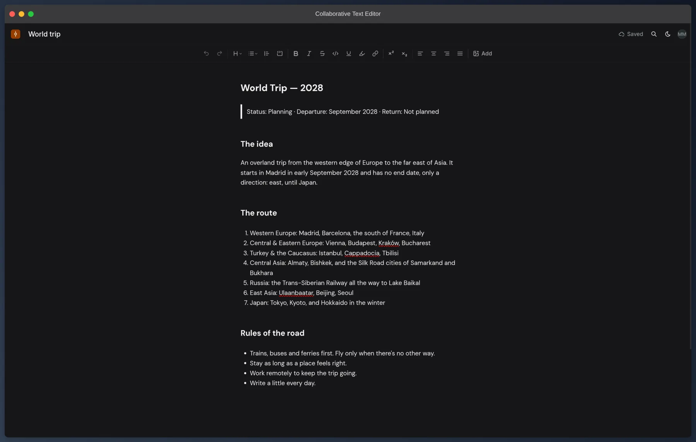
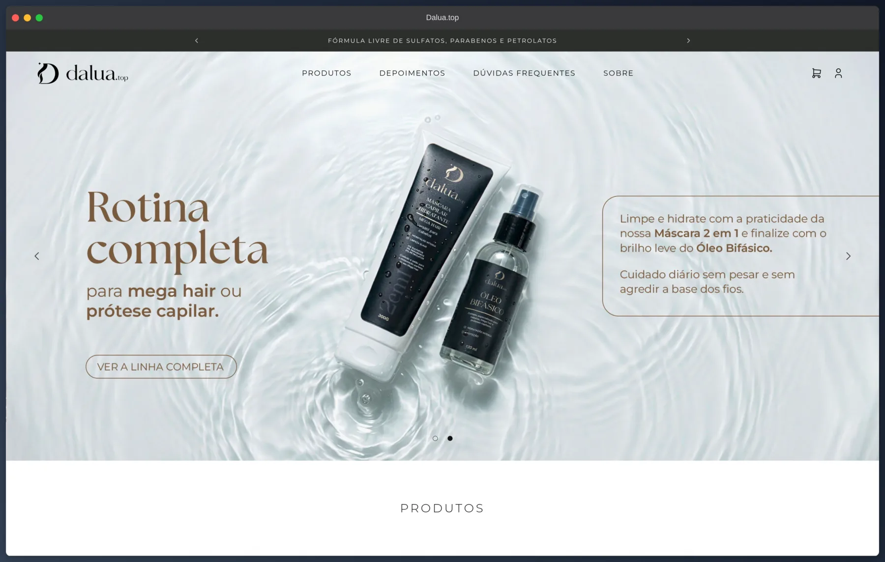
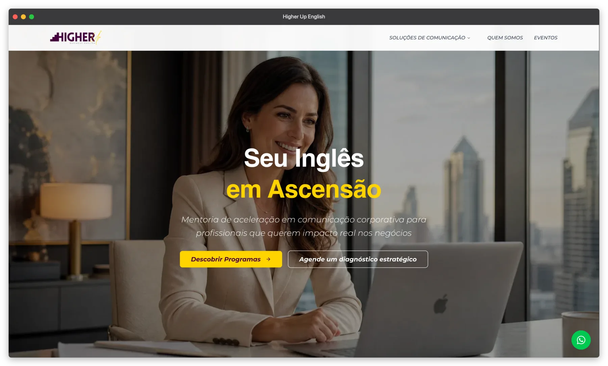

# Olá, eu sou o Mikael 👋

**Engenheiro Fullstack · 6+ anos · TypeScript, React/Next.js, Node.js/Bun, AWS**

🌎 **Aberto a oportunidades internacionais** · Remoto do Brasil (UTC-3, sobreposição com EUA e Europa) · Inglês: fluente

🇺🇸 [Read in English](README.md)

---

Entrei no desenvolvimento criando jogos na Unity3D e nunca parei. O que me prendeu não foi a tecnologia em si, mas a sensação de transformar uma ideia em algo que funciona. Hoje construo sistemas web, mobile e backend nos segmentos de apostas, automação enterprise e logística, e tenho conforto em assumir a entrega de ponta a ponta, das decisões de arquitetura até a produção.

## Destaques de impacto

- **Failover em tempo real na AWS.** Construí um sistema de failover automático em microserviços que detecta quedas de provedor e faz a troca em tempo real, mantendo disponível uma plataforma de apostas regulamentada.
- **Bilhões de registros, zero perda de dados.** Atuei em uma migração intercontinental da Europa para o Brasil usando AWS e Python.
- **~10% de crescimento de receita.** Desenvolvi um sistema de indicações fullstack em um time de 2 pessoas.
- **De 4 dias para 2 horas.** Projetei um pipeline de automação integrando 3 bancos de dados com Lecom, DocuSign e Feedz via REST APIs.
- **Milhões de linhas sem travar a API.** Arquitetei uma fila de mensagens na AWS para processar planilhas Excel de forma assíncrona em um produto da AbInBev, entregue solo em 2 semanas.

---

## Projetos em destaque

### [Collaborative Text Editor](https://collaborative-text-editor.mmarceniuk.dev/)

Editor de documentos no estilo Google Docs simplificado, com editor rico, autosave e modo convidado. O produto é propositalmente simples, para o esforço ficar na engenharia de sincronização e persistência.

- Documentos modelados como **CRDT com Yjs**: o servidor recebe updates binários e faz o merge antes de persistir no MongoDB, então edições concorrentes convergem sem lock e sem last-write-wins.
- Escritas protegidas por concorrência otimista, e autosave com debounce, backoff exponencial e um flush final quando a aba fecha.
- Modo convidado: qualquer pessoa começa a escrever sem cadastro, e os documentos migram para a conta quando ela se registra.
- Monorepo com CI separado para web e server; um release só publica se os dois passarem (API no Fly.io, web na Vercel).

**Stack:** React, TypeScript, Tiptap, Yjs, Express, MongoDB, Better Auth, GitHub Actions 
**Links:** [Demo ao vivo](https://collaborative-text-editor.mmarceniuk.dev/) · [Código-fonte](https://github.com/MikaelMarceniuk/collaborative-text-editor)

### [Dalua.top](https://dalua.top/) · *Freelance*

Loja virtual completa para uma marca de cuidados capilares: catálogo, carrinho, checkout com Mercado Pago, frete calculado pelo Melhor Envio e um painel onde a dona gerencia produtos, pedidos, cupons e conteúdo sem depender de um desenvolvedor.

- Roda numa hospedagem já contratada pelo cliente, com MySQL e sem acesso externo: as migrations são aplicadas automaticamente no boot do servidor, e o build roda no GitHub Actions e é publicado numa branch de deploy.
- Provedores de pagamento e frete conectados por **OAuth2** pela própria dona da loja, com tokens criptografados em **AES-256-GCM** e renovação dentro de uma transação com lock de linha, já que o refresh token é de uso único.
- Imagens convertidas para WebP no servidor e vídeos de depoimento convertidos no próprio navegador.

**Stack:** Next.js, TypeScript, MySQL, Drizzle, Better Auth, Mercado Pago, Melhor Envio, GitHub Actions 
**Links:** [Site ao vivo](https://dalua.top/) · Projeto de cliente, código privado

### [Higher Up Business English](https://higher-up.com.br/) · *Freelance*

Site institucional da única empresa no Brasil com metodologia BELF (Business English as a Lingua Franca), feito para ser encontrado no Google e transformar visitas em contatos.

- Páginas por solução e público (empresas, profissionais, startups, professores), para cada visitante cair numa página escrita para ele.
- Bilíngue (português e inglês) com next-intl e rotas por idioma, mais metadata, sitemap e robots gerados pela aplicação para o SEO.
- Analytics sem cookies com Umami, então o site não precisa de banner de consentimento. Publicado como imagem Docker construída pelo GitHub Actions.

**Stack:** Next.js, TypeScript, next-intl, Umami, Docker, GitHub Actions 
**Links:** [Site ao vivo](https://higher-up.com.br/) · Projeto de cliente, código privado

---

## Stack

**Frontend** 

**Backend** 

**Dados** 

**Cloud & DevOps** 

---

## Fora do código

Estudo teatro, atualmente no terceiro ano, com foco em teatro contemporâneo. Isso molda como penso sobre comunicação, no palco e em um time.

Leio bastante, principalmente livros de programação, livros sobre como lidar com pessoas e ficção de terror e detetive. No momento estou lendo *A Philosophy of Software Design*, *The Pragmatic Programmer* e *Never Split the Difference*. Favoritos recentes: *Na Escuridão da Mente*, de Paul Tremblay, e *O Bom Filho*, de You-jeong Jeong.

Também estudo russo (B2) e japonês (A1) ao mesmo tempo, porque aparentemente gosto de sistemas complexos.
